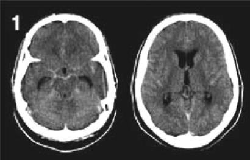
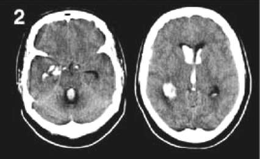
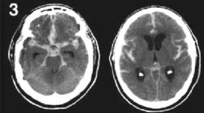
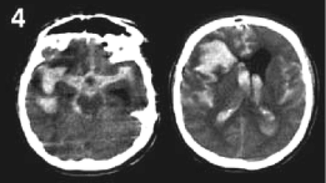
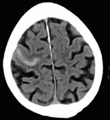
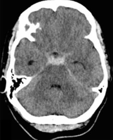

Aneurysmal subarachonid hemorrhage (aSAH) is the most common type of SAH, also representing the third most common acute vascular event behind acute ischemic stroke and intraparenchymal hemorrhage.

# Signs/Symptoms of aSAH

**Thunderclap headache**

*Definition per ICHD-3:* Abrupt onset, reaching maximum intensity in \<1 minute and lasting for ≥5 minutes\
*Differential diagnosis:* SAH, pituitary apoplexy, arterial dissection, DVST, hypertensive emergency, RCVS, intracranial hypotension, primary thunderclap headache

**Loss of Consciousness**

Can happen in about 50% of aSAH cases, brief or prolonged and is associated with worse clinical grade

**Meningismus**

Neck pain or stiffness, photophobia, and back pain. Neck signs are often absent in the first hours

**Third Nerve palsy with pupillary involvement**

Points to a posterior communicating artery aneurysm

**Other focal deficits**

From intracerebral extension, mass effect, or emboli from the aneurysm

**Seizures**

When occuring **at ictus of headache** can be associated markers of severe early brain injury such as Fisher 3--4, IVH, ICH and hydrocephalus. If **during next 24h** with re-reputure. Incidence of eletrographical seizures **during ICU can reach 30%.**

# Immediate management

## Confirm the diagnosis

-   Non-contrast CT head; Negative Predictive value close to 100% **within the** **first 6 hours from headache ictus**
-   LP if CT findings are normal and suspicion remains high. **Xanthochromia is usually seen 6 hours after headache ictus**

## Grade Clinically

### Hunt and Hess

| Grade | Description                                           |
|-------|-------------------------------------------------------|
| 0     | unruptured aneurysm                                   |
| 1     | asymptomatic or mild HA and nuchal rigidity           |
| 1a    | no meningeal signs but have fixed neurologic deficit  |
| 2     | CN palsy, mod/severe HA, nuchal rigidity              |
| 3     | mild focal deficit, confusion or drowsiness           |
| 4     | stupor, mod/severe hemiparesis                        |
| 5     | deep coma, decerebrate posturing, moribund appearance |

::: callout-note
Consider adding one grade for severe vasospasm on angiogram or severe systemic disease.
:::

## Grade radiologically

### Modified Fisher Scale

::: panel-tabset
### Grade 1

**Thin focal or diffuse SAH · No IVH**

-   Thin = \< 1 mm\
-   Symptomatic vasospasm risk: ≈ 24%



### Grade 2

**Thin focal or diffuse SAH · With IVH**

-   Thin SAH + any IVH\
-   Symptomatic vasospasm risk: ≈ 33%



### Grade 3

**Thick focal or diffuse SAH · No IVH**

-   Thick = ≥ 1 mm (or completely filling ≥ 1 cistern/fissure)\
-   Symptomatic vasospasm risk: ≈ 33%



### Grade 4

**Thick focal or diffuse SAH · With IVH**

-   Thick SAH + any IVH\
-   Symptomatic vasospasm risk: ≈ 40% (highest)


:::

# Differential for SAH beyond aSAH

+-------------------------------------------------------+------------------------------------------------------------------------------------------------------------------------+
| Imaging pattern                                       | Differential                                                                                                           |
+=======================================================+========================================================================================================================+
| [**Sulcal**]{.underline}                              | RCVS, DVST, vasculitis, mycotic aneurysm, trauma, amyloid angiopathy, meningeal neoplasm, dural AV fistula, meningitis |
|                                                       |                                                                                                                        |
|             |                                                                                                                        |
+-------------------------------------------------------+------------------------------------------------------------------------------------------------------------------------+
| [**Perimesencephalic**]{.underline}                   | primitive venous drainage variants, aSAH from posterior circulation (basilar tip, SCA, AICA, PICA), dural AV fistula   |
|                                                       |                                                                                                                        |
|  |                                                                                                                        |
+-------------------------------------------------------+------------------------------------------------------------------------------------------------------------------------+

# Events and complications after aneurysmal SAH

+----------------------------------------------------------+-------------------------------------------------+
| Early                                                    | Late                                            |
+==========================================================+=================================================+
| Rebleeding                                               | Cerebral vasospasm                              |
+----------------------------------------------------------+-------------------------------------------------+
| Acute hydrocephalus                                      | Delayed cerebral ischemia                       |
+----------------------------------------------------------+-------------------------------------------------+
| Seizures                                                 | Pituitary dysfunction                           |
+----------------------------------------------------------+-------------------------------------------------+
| Cardiopulmonary issues and stress induced cardiomyopathy | Infection related to surgery or ventriculostomy |
+----------------------------------------------------------+-------------------------------------------------+
| Sodium and electrolyte abnormalities                     |                                                 |
+----------------------------------------------------------+-------------------------------------------------+

# Chronic complications of aSAH

-   Long term VP Shunt

-   Psychiatric (memory deficits, MDD, GAD, personality changes)

-   Retreatment, periodic DSAs for stbaility

# Consult Note - Assessment and Plan

```         
# Subarachnoid Hemorrhage
Onset of headache:
Hunt&Hess:       | Modified Fisher:
- SBP < 160mmHg (prior to securing)
    - PRN labetalol 10 mg IV if HR >60, hydralazine 10 mg IV for HR <60
    - For refractory HTN, initiate nicardipine infusion and titrate to effect
    - Consider Arterial line for close blood pressure monitoring
- Nimodipine 60 mg every 4 hours by mouth or NG tube for 21 days for delayed cerebral ischemia prophylaxis 
    - Transition to 30 mg q2h if the patient develops hypotension with typical dosing
    - Can also consider Nimodipine 15mg Q1h
- Consider STAT EEG
- Bedside Yale Screen
    - No oral meds prior to bedside dysphagia screen
- Neurosurgery consultation for DSA and/or EVD
    - EVD if patient has depressed LOC and hydrocephalus
- NC q1h
- Acetaminophen 1g q6h if no liver disease 
- Oxycodone 5-10mg q6h hours PRN 
- Consider pterygopalatine fossa (PPF, suprazygomatic SPG) block
- Consider Occipital Nerve Block
- Avoid NSAIDs
- Avoid Valsalva maneuver: use antiemetics, antitussives and stool softeners
- Daily electrolytes to monitor for hyponatremia
- Bedrest
- Strict I/O, maintain euvolemia
- Hold all home antithrombotic medications
- DVT prophylaxis: SCDs, no SC heparin
- Restart DVT prophylaxis after aneurysm securement
- STAT CT Head if neurologic deterioration
```

# Unit 47 - Assessment and Plan

```         
Neurological A/P: 
Principal Problem(s): ***
Onset of headache:
Hunt&Hess:       | Modified Fisher:
Pain/sedation: Acetaminophen 1g q6h if no liver disease | Oxycodone 5-10mg q6h PRN 

- Nimodipine 60 mg every 4 hours by mouth or NG tube for 21 days for delayed cerebral ischemia prophylaxis 
    - Transition to 30 mg q2h if the patient develops hypotension with typical dosing
    - Can also consider Nimodipine 15mg Q1h
- Neurosurgery consultation for DSA and/or EVD
    - EVD if patient has depressed LOC and hydrocephalus
- NC q1h
- Consider STAT EEG
- STAT CT Head if neurologic deterioration
- Consider Occipital Nerve Block
- Avoid NSAIDs
- Avoid Valsalva maneuver: use antiemetics, antitussives and stool softeners as bellow
- Daily electrolytes to monitor for hyponatremia
- Bedrest
- PT/OT: {YES/NO:20566}

Respiratory A/P: 
Airway: ***
Vent settings:  
Pulmonary toilet: ***

Cardiovascular A/P: 
MAP/SBP goal: SBP < 160, MAP > 65
- SBP < 160mmHg (prior to securing)
    - PRN labetalol 10 mg IV if HR >60, hydralazine 10 mg IV for HR <60
    - For refractory HTN, initiate nicardipine infusion and titrate to effect
    - Consider Arterial line for close blood pressure monitoring
Drips: ***
TTE: ***
ECG: ***


Infectious A/P: 
ABX: ***
Cultures: ***
C. auris screening (if inmate or medical facility resident): ***

Renal A/P: 
- Strict I/O, maintain euvolemia
- Daily electrolytes to monitor for hyponatremia
Volume status: 
Fluid/drips: *** 
Foley: {YES/NO:20566}, {should be inserted}
Electrolyte protocol: {YES/NO:20566}
        
GI /Nutrition A/P: 
- Bedside dysphagia evaluation to be performed by nursing
    - No oral meds prior to bedside dysphagia screen
Avoid Valsalva
- Anti-emetics:
        - Ondansetron 4 mg IV/PO q6h PRN, avoid if QTC > 420mcsec
        - Prochlorperazine 10 mg IV q6h PRN
    - Anti-tussives:
        - Dextromethorphan 15-30 mg PO q6h PRN
    - Stool softeners:
      - Polyethylene glycol 17 g PO daily
      - Senna 8.6 mg PO nightly 
        - Docusate 100 mg PO BID PRN
Diet: Pending Swallow eval
Nutrition Route:  Pending swallow eval
Stress ulcer PPx: 
    
Endocrine A/P: 
Insulin: ***

Hematologic A/P: 
PPx: SCDs, no SC heparin
Restart DVT prophylaxis after aneurysm securement
Antiplatelets/Anticoagulants: Hold all
CVL: {YES/NO:20566}; date placed: ***

Wound A/P:
Skin intact: {YES/NO:20566}
Interventions: ***

ICU consents obtained: {YES/NO:20566}
```
